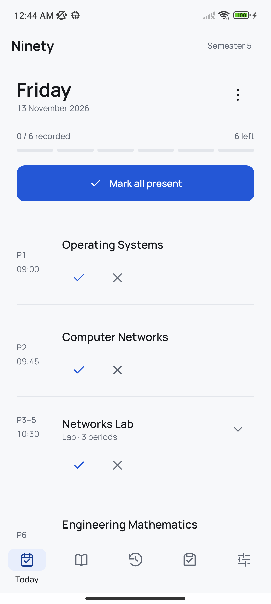
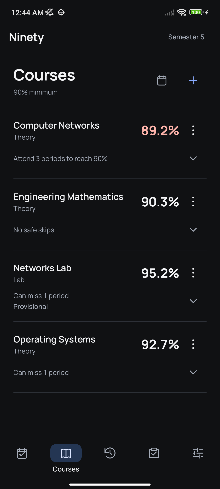

# Ninety

Ninety is an offline Android attendance tracker with a fixed **90% minimum per course**. Every academic period counts as one unit, including each period in a lab and each shorter Friday period. Periods marked Duty leave earn attendance credit immediately.

## Using Ninety

1. Create a semester, add theory and lab courses by name, and assign periods in the weekly timetable. If you're starting mid-semester, choose whether to enter **Attendance so far** or mark past days individually.
2. On **Today**, tap **Mark all present** or use the inline Present and Absent controls. **Mark remaining present** preserves earlier marks. On a completed day, the **All _n_ marked** summary appears and the controls stay in place. Expand a lab with **View periods** to edit its individual marks. Use **Previous day** to reach yesterday or **Catch up** to open the oldest unmarked day. Use the period actions to mark **Duty leave** for one period, or the day menu to mark several at once. The day menu also covers holidays, copied timetables, and extra classes. Extra classes are excluded from attendance by default.
3. In **Courses**, see each course’s percentage and how many periods you can miss or need to attend. Tap a course for its breakdown, unmarked dates, and course actions. Edit historical duty leave totals in **Attendance before tracking**. Open **Timetable** to view or edit the weekly schedule. Expand **No longer tracked** to find a stopped course and resume it.
4. In **Calendar**, use the month grid or the list of earlier unmarked days to open a date. The **Today** button returns to the current month.
5. In **Settings**, open a semester to view its records, edit its details, or change its status. Use **Display** for theme and haptics, **Reminder** for the optional daily notification, and **Recent changes** for available undo actions. **Backup** shows the last successful save on this device. Restore previews the selected file and asks before replacing data. **About Ninety** includes the attendance rules and font license.

Tap the selected tab to return to its root. When there is more than one semester, tap the semester name in the top bar to switch which one you’re viewing.

[PROJECT_SPEC.md](PROJECT_SPEC.md) defines the attendance rules. [VERIFICATION_SUMMARY.md](VERIFICATION_SUMMARY.md) records the redesign checks and remaining device work.

## Screenshots

The images below are historical captures from the five-tab interface using a synthetic semester. The current layout uses **Today**, **Courses**, **Calendar**, and **Settings**, with **Timetable** inside Courses and duty leave available through attendance actions. See the [screenshot notes](docs/screenshots/README.md) for the current host captures and their coverage.

<p>
  
  
</p>

## Build and install

Ninety 1.0.3 runs on Android 8.0 / API 26 or newer. Building uses JDK 21, Android API 37.0, SDK Build Tools 36.0.0, and the checked-in Gradle wrapper. The version catalog pins the build and library versions.

Set `ANDROID_HOME` to the SDK directory, or put `sdk.dir=/absolute/path/to/sdk` in an untracked `local.properties`.

```sh
./gradlew :app:assembleDebug :app:assembleRelease
```

The debug APK is `app/build/outputs/apk/debug/app-debug.apk`. The minified release is `app/build/outputs/apk/release/app-release.apk` when the local debug keystore is available. Ninety's local release uses the existing development signing key so it can upgrade the existing installation. The key isn't committed. This is a local sideload release; it hasn't been published.

For an existing installation signed with the same key, use `adb install -r <apk>` to retain data. If Android rejects the signature, stop and check the APK. Uninstalling or clearing app storage removes local attendance unless you have an exported backup.

## Verify and contribute

```sh
./gradlew :domain:test :app:testDebugUnitTest :app:lintDebug :app:lintRelease \
  :app:assembleDebug :app:assembleRelease :app:assembleDebugAndroidTest
```

The domain suite covers the attendance rules. JVM tests cover Room workflows, backup validation and restore, Compose lifecycle, leave interactions, and the main attendance paths. Test and lint reports live under each module's `build/reports/`, and synthetic UI captures are generated in `app/build/qa/v1/`. GitHub Actions is configured for the host checks. Its existence does not mean a hosted run has occurred.

Read the spec before changing attendance policy. Keep changes focused and describe the actual test results. Use synthetic data for screenshots. The owner has not selected an open-source license.

### Safe tests on a personal phone

Keep `android.injected.androidTest.leaveApksInstalledAfterRun=true`. Never uninstall, clear data, delete the live database, or enable orchestrator clear-data mode. Use an authorized, awake phone in Android user 0. Install the matching debug APK in place and open it once before the test run.

```sh
export ANDROID_SERIAL=your_authorized_device_serial
export ADB=/absolute/path/to/platform-tools/adb  # only needed if adb is not on PATH
python3 scripts/verify_device_tests.py
# Include the real UI journey only when authorized to create a named test semester:
python3 scripts/verify_device_tests.py --allow-ui-fixtures --miui-foreground
```

By default the wrapper excludes the journey and checks unchanged database and WAL hashes. Other tests use in-memory Room or named migration and persistence fixtures. The full suite's journey writes only through the real app UI and leaves a `Device Test …` semester. For that mode, the wrapper verifies the same UID, first installation time and app data directory, and checks that the database is still readable; it allows the expected database changes. Only hashes and package metadata are read out of the phone. `--miui-foreground` is optional and responds to MIUI blocking the test activity, without changing security settings.

## Architecture and privacy

`:domain` owns the exact calculation and scheduling rules. `:app` uses Compose, Room and WorkManager for the UI, local storage and optional reminders. Dated sessions retain their identities; opening balances cover periods before the first logging date. Database migrations preserve data, and backup validation precedes transactional replacement.

Ninety has no account, server, analytics or Internet permission. Automatic cloud backup and device transfer are disabled. A user-initiated JSON backup uses Android's file picker; choose a location you control. Current exports and restores use backup format 3. During the database upgrade to schema 4, previous duty leave marks become unrecorded, opening duty leave counts reset to zero, and previous Undo history is cleared. Ordinary attendance and other semester data are preserved.

The interface bundles D-DIN Regular and Bold under the SIL Open Font License 1.1. Its notice is available from Settings → About Ninety → Font license.
