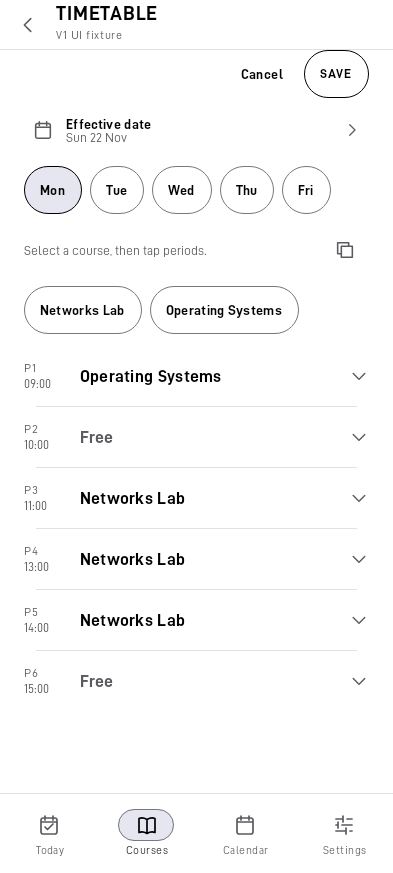

# Ninety

Ninety is an offline Android attendance tracker for college timetables with a **90% minimum per course**. Log attendance by period and see how many periods you can miss or need to attend to reach the minimum.

## Install on Android

Open the [latest GitHub release](https://github.com/vsniranjan/ninety/releases/latest), download the `Ninety-*.apk` file under **Assets**, and open it on your phone. Ninety requires Android 8.0 or later.

If you already use a development build, export your data from **Settings → Backup** before switching. If Android reports a signing conflict, uninstall the development build only after confirming that you saved the backup. Install the release and restore the backup from Settings.

## What you can do

- Set up a semester, courses, and a weekly timetable. Enter opening balances if you start tracking partway through the semester.
- Mark the whole day present, log individual periods, or expand a lab to mark its periods separately. Duty leave earns attendance credit when recorded.
- Catch up on unmarked days in the calendar, record holidays, copy a weekday's timetable to a special date, or add extra classes.
- Check each course's totals, set an optional reminder, undo recent changes, and export or restore a JSON backup.

## Screenshots

These screenshots show a synthetic semester from the app's automated UI tests.

<p>
  
  
</p>

## Build and run

Ninety runs on Android 8.0 (API 26) and later. For a local build, install JDK 21 and the Android SDK packages `platforms;android-37.0` and `build-tools;36.0.0`. Install Android SDK Platform-Tools to use `adb`. Set `ANDROID_HOME` to your SDK directory or use `sdk.dir` in a local `local.properties` file. Open the project in Android Studio or use the checked-in Gradle wrapper (`gradlew.bat` on Windows).

```sh
./gradlew :app:assembleDebug
adb install -r app/build/outputs/apk/debug/app-debug.apk
```

Android requires the same signing key to update an existing installation. If the signatures differ, export your attendance data from the existing app before switching builds.

`./gradlew :app:assembleRelease` builds the minified APK at `app/build/outputs/apk/release/app-release-unsigned.apk`. For a local sideload using your existing Android debug key, pass `-Pninety.signReleaseWithDebugKey=true`. Use a private release signing key for distribution.

## Verify changes

```sh
./gradlew :domain:test :app:testDebugUnitTest :app:lintDebug :app:lintRelease \
  :app:assembleDebug :app:assembleRelease :app:assembleDebugAndroidTest
```

GitHub Actions runs the same host checks and verifies the committed Room schemas. Test and lint reports are under each module's `build/reports/`. The app tests generate synthetic screenshots under `app/build/qa/v1/`. See [device testing](docs/device-testing.md) for instrumentation instructions.

The [attendance rules](docs/attendance.md) describe the timetable, eligibility, and calculation. The `:domain` module implements the calculation and schedule resolution. The `:app` module contains the Compose UI, Room storage, and WorkManager reminders. When changing persistence, include the corresponding Room schema and migration coverage.

## Data and privacy

Ninety stores records on the device and uses no accounts, analytics, or Internet permission. App backup rules exclude attendance data from automatic backup and device transfer. The only export is the JSON backup you choose to save through Android's file picker. It contains your attendance records. Restore previews the file before replacing local data.

The app writes backup format 3. During migration from database schema 3 to 4, old duty leave marks become unrecorded, opening duty leave counts reset to zero, and previous undo history is cleared.

## Licensing

The app source has no open-source license. The bundled D-DIN fonts use the [SIL Open Font License 1.1](app/src/main/res/raw/d_din_license.txt).
